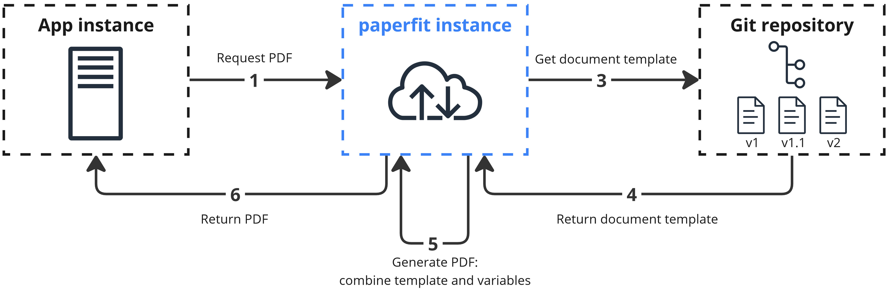

# paperfit

paperfit is a service that creates PDFs by integrating variable data into pre-designed HTML templates.

## Goals

- Build HTML templates with any modern frontend framework, supporting HTML, CSS, JavaScript (`<canvas>` too)
- Enable template versioning
- Dynamic PDF content. Variable inputs offer limitless customization in templates through JavaScript.
- Ensure fast generation
- Cache PDFs for better performance
- Multiple caching options: Object storage solutions (AWS, GCS, Minio, Dropbox and more) or local file system.

## Typical use case



A ***typical paperfit*** instance operates alongside the main backend application.

HTML templates, built using any modern frontend framework, are published to a package registry like GitLab, allowing version control.

To request a PDF, the main application specifies the template's registry URL and desired version.<br />Variables can be passed in the request, which are merged with the template and made available to JavaScript within the template.

***paperfit*** generates the PDF, optionally caches it for future use, and returns it to the main application.

### Current Limitations

- Template repositories must be flattened, meaning all file paths such as `/dirA/dirB/file.js` need to be simplified to `/file.js`. This requirement stems from the use of [Gotemberg](https://gotenberg.dev/) for PDF generation.
- Encryption and decryption for cached files are still in the testing phase. However, most object storage solutions already offer built-in support for this feature.

## Prerequisites

- [ASDF](https://asdf-vm.com/)
  - [golang plugin](https://github.com/asdf-community/asdf-golang)
- [Docker](https://docs.docker.com/engine/install/)
  - [Compose](https://docs.docker.com/compose/install/)

## Setup

```sh
# install task runner
go install github.com/go-task/task/v3/cmd/task@latest
# reshim ASDF after installing packages
asdf reshim golang
```

```sh
# install dependencies
task install_global
# copy env file
task setup
```

Make sure GOPATH/GOROOT are set and $GOPATH/bin is in your PATH, e.g.

```sh
export GOPATH=$(asdf where golang)/packages
export GOROOT=$(asdf where golang)/go
#export PATH="${PATH}:$(go env GOPATH)/bin"
```

## Development

First, start the docker stack:

```sh
task docker
```

Then, you can start the dev server:

```sh
task dev
```
#
### Format

```sh
task format
```

### Test

Make sure you have created a bucket, created an access key and set `CACHE_URL` accordingly: 

`minio://<bucket-name>?credential=hmac:<access-key-name>:<access-key-value>&endpoint=http:localhost:9000`

You can then run tests with:

```sh
task test
```

### Lint

```sh
task lint
```
